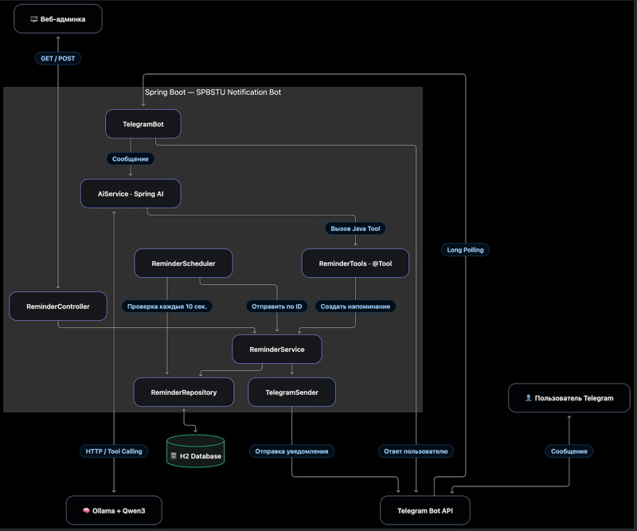

# Техническое описание
## SPBSTU Notification Bot

### 1. Общая архитектура

SPBSTU Notification Bot представляет собой монолитное Java-приложение на Spring Boot, интегрированное с Telegram Bot API и локальной языковой моделью Qwen3 через Ollama и Spring AI.

Приложение состоит из следующих компонентов:

- **TelegramBot** — получение сообщений пользователей через Long Polling и отправка ответов.
- **AiService** — взаимодействие с локальной языковой моделью через Spring AI.
- **ReminderTools** — предоставление языковой модели Java-инструмента для создания напоминаний.
- **ReminderService** — бизнес-логика создания, получения и отправки напоминаний.
- **ReminderRepository** — взаимодействие с базой данных H2 через Spring Data JPA.
- **ReminderScheduler** — периодическая проверка запланированных напоминаний.
- **TelegramSender** — отправка сообщений через Telegram Bot API.
- **ReminderController** — REST API административной панели.
- **AdminController** — предоставление HTML-страницы администратора.

### 2. Диаграмма последовательности

### 3. Описание работы сервиса

**Создание напоминания.** Пользователь отправляет текстовое сообщение Telegram-боту. Полученный запрос передаётся в локальную языковую модель через Spring AI.

Модель анализирует намерение пользователя и при необходимости формирует вызов инструмента `createReminder` с текстом напоминания и запланированной датой.

Spring AI вызывает соответствующий Java-метод. `ReminderService` проверяет корректность параметров и сохраняет запись в H2 со статусом `PENDING`.

**Автоматическая отправка.** Компонент `ReminderScheduler` периодически обращается к базе данных и получает напоминания, время которых наступило. Для найденных записей вызывается `ReminderService.sendReminder()`.

После успешной отправки сообщения через Telegram Bot API статус напоминания изменяется на `SENT`.

**Ручная отправка.** Администратор может открыть веб-панель, посмотреть активные напоминания и отправить выбранное уведомление принудительно. Веб-интерфейс взаимодействует с приложением через REST API.

### 4. Используемые технологии

| Технология | Назначение                        |
|---|-----------------------------------|
| Java 17+ | Язык программирования             |
| Spring Boot 4.1.1 | DI Framework                      |
| Spring AI | Интеграция с языковой моделью     |
| Ollama | Локальный сервер LLM              |
| Qwen3 4B | Обработка естественного языка     |
| TelegramBots | Интеграция с Telegram             |
| Spring Data JPA / Hibernate | Работа с БД                       |
| H2 Database | Хранение напоминаний              |
| Spring Scheduling | Выполнение задач по расписанию    |
| Thymeleaf, HTML, CSS, JavaScript | Административная панель           |
| Maven | Сборка и управление зависимостями |

### 5. Демонстрация работоспособности

Для подтверждения реализации функциональности необходимо приложить следующие скриншоты:

1. **Telegram:** создание напоминания текстовым сообщением и получение подтверждения.
2. **Telegram:** автоматическое получение уведомления по расписанию.
3. **H2:** сохранённые напоминания с соответствующими статусами.
4. **Веб-админка:** таблица активных напоминаний.
5. **Веб-админка:** принудительная отправка уведомления.

### 6. Результаты разработки

В рамках курсового проекта реализованы основные компоненты сервиса управления напоминаниями с использованием локальной LLM.

Разработанное приложение позволяет создавать напоминания на естественном языке, сохранять их в базе данных, автоматически отправлять уведомления и управлять активными напоминаниями через веб-интерфейс.

**Количественные характеристики проекта:**

| Показатель                            | Значение                              |
|---------------------------------------|---------------------------------------|
| REST API эндпоинты                    | 2                                     |
| Страниц UI (админка)                  | 1                                     |
| Количество Java-классов и интерфейсов | 13                                    |
| Количество строк кода                 | 431                                   |

**Применённые архитектурные подходы:** многослойная архитектура, Dependency Injection, Repository Pattern, Tool Calling.

### 7. Вывод

В результате разработки создан сервис автоматизации напоминаний, использующий локальную языковую модель для интерпретации пользовательских запросов.

Использование Spring AI позволило интегрировать механизм вызова Java-инструментов, а применение Spring Boot обеспечило разделение бизнес-логики, интеграционных компонентов и пользовательских интерфейсов.

Разработанное решение демонстрирует практическое применение локальной LLM для выполнения прикладных задач, выходящих за пределы обычного чатового взаимодействия.